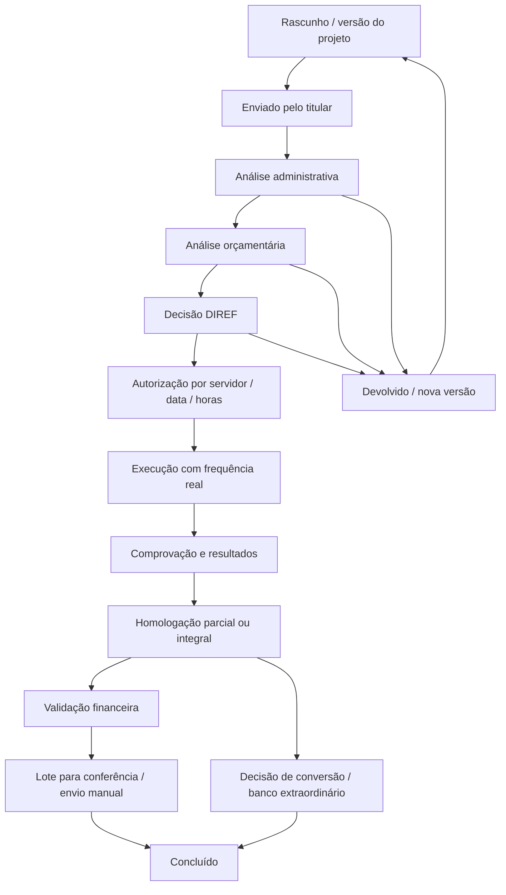

# Especificação funcional e arquitetura — fase 1

Concluída como desenho técnico em 17/10/2026, após auditoria e matriz. Não equivale a homologação normativa. A implementação deve atualizar o relatório de validação por incremento.

## Contratos e invariantes

- Manter `src/modules/horas-extras` nas camadas existentes, `RemuneracaoProvider`, calendário institucional, jornada/escala, marcações e RBAC. O órgão é o escopo institucional existente; não criar tenant novo.
- Separar seis regimes: ordinário, crédito ordinário, extraordinário pecúnia, extraordinário banco, recesso extraordinário e não reconhecido. Um trecho real de frequência só pode financiar um destino. Preservar IDs de marcações e decisões de origem.
- Autorização administrativa, disponibilidade financeira, execução, comprovação, homologação e inclusão na folha são fatos independentes. Nenhum botão de aprovação deve inventar os demais.
- Datas civis estritas e calendário por abrangência; timestamps de marcações no fuso da origem. Dividir intervalos reais em meia-noite e mudança de calendário/jornada, sem criar marcação inexistente. Marcação ímpar impede reconhecimento do dia até tratamento documentado.
- Limites por servidor/data/mês/ano agregam as autorizações e execuções correlatas sem contar duas vezes a mesma autorização executada. Cancelamento libera apenas reserva não consumida. Alteração de competência/regime não contorna teto.
- Em dinheiro: cálculo decimal, arredondamento explícito por item em centavos e soma de itens; divisor 200h = 12.000min. Rubricas da base e de saída têm finalidade diferente. Memória fixa base, vigência, fonte, regras e fatores. Snapshot homologado/encaminhado nunca é refeito em lugar.
- Sem remuneração válida e inequívoca na data, sem rubricas aprovadas ou com base histórica não comprovada: pendência explícita, jamais base atual como substituta.
- Acesso financeiro exige permissão de ação e escopo de órgão; leitura não autoriza mutação. Escopo vazio nega acesso. Não devolver payload salarial integral a gestores ou à área administrativa sem necessidade funcional.

## Modelo incremental proposto (não aplicado ao banco nesta fase)

| Conceito | Reutilizar | Extensão aditiva proposta |
|---|---|---|
| Campanha | Órgão, unidade, política/workflow versionados | `OvertimeCampaign` com exercício, nome, SEI, documento, vigência, prazos e status; `OvertimeCampaignUnit` com órgão/unidade e referência independente do financeiro. |
| Finanças | Parecer `OvertimeBudgetReview` | Conta por campanha/unidade e `OvertimeBudgetMovement` imutável: dotação, descentralização, reserva, liberação, remanejamento, execução e encaminhamento. Movimentos idempotentes, valores Decimal, documento e ator. |
| Projeto coletivo | `OvertimeRequest` e dias existentes | Cabeçalho de projeto do titular ligado a solicitações por servidor; campanhas opcionais para legado. `OvertimeRequestVersion` com conteúdo fechado, hash, anterior e motivo; retificação não sobrescreve versão autorizada. |
| Autorizações | `OvertimeAuthorization` e `AutorizacaoHoraExtraAdministrativa` | Vínculo de proveniência opcional, versão do projeto/decisão, sem unificação destrutiva das duas tabelas. Adaptador distingue legado e SECAP; deduplicação exige decisão documentada. |
| Execução | `HoraExtraExecucaoIntervalo`, classificações, apuração e marcações | Evidência de intervalo, jornada e saldo histórico; identificador único do trecho consumido/destino; pendências e decisão humana documentada. |
| Comprovação | `HoraExtraAtesto` e eventos | Documentos/resultados por servidor/dia, quantidades autorizadas/executadas/comprovadas/homologadas/rejeitadas, decisões parciais com versões. |
| Banco extraordinário | Infraestrutura de extrato/FIFO | Crédito tipado extraordinário, fator, validade art.50-A, conversão e origem; não reutilizar expiração/teto ordinário como padrão. |
| Remuneração | Interface, snapshots e cálculo existentes | Cadastro de rubricas com código/natureza/fundamento/vigência/validador RH; vigências documentadas por servidor com provenance, histórico de cargo/função e cálculo versionado. |
| Folha | Lote/linhas e checksum | Consumo único global da classificação e versão homologada, situação financeira e leiaute externo validado. Não efetivar folha automaticamente. |
| Auditoria | `AuditoriaEvento`, `HoraExtraEvento` | Perfil ativo, before/after, justificativa, SEI e correlação em cada mutação, sem dados salariais desnecessários no log. |

Reservas usam transação serializável ou lock da conta e chave idempotente única; verificar saldo **descentralizado**, deduzindo compromissos ainda não liquidados, dentro do lock. Remanejamento registra débito/crédito na mesma transação, com mesmas condições de crédito de origem; não cria disponibilidade por aumentar valor de referência. Retentar conflitos serializáveis com limite e mensagem clara. Testar com duas conexões reais ao PostgreSQL.

## Fluxo

Rejeição/cancelamento são decisões auditadas com justificativa. Retificação gera nova versão e nova aprovação antes de executar o objeto alterado. Não muda retrospectivamente a autorização de um serviço já prestado. O registro SECAP de documento externo entra no fluxo em autorização, com origem explícita e validações equivalentes antes do reconhecimento financeiro. A conversão dispensa pagamento, mas não competência e comprovação.

## Experiência e telas

Reutilizar layout e componentes institucionais. Dropdowns pesquisáveis e opções restritas a órgãos/unidades ativos; históricos preservam rótulos snapshot sem reintroduzir órgão inativo em filtros. Todas as telas exibem referência da regra relevante e pendências sem linguagem de aprovação automática.

| Tela | Comportamento esperado |
|---|---|
| Dashboard | Filtros órgão/unidade/pessoa/matrícula/campanha/período/exercício/status/regime/financeiro/tipo de dia/SEI; indicadores por fase, sem somar fases como novos créditos. |
| Campanhas | Cadastro versionado, unidades participantes, referência versus dotação/descentralização/reserva/saldo, prazos e remanejamento. |
| Solicitações | Lista por escopo, versão atual e decisões anteriores; novo projeto do titular. |
| Stepper (5 etapas) | Identificação; justificativa específica; servidores/datas/horas/atividade/jornada/custo; validações normativas; confirmação e PDF para SEI. |
| Retificações | Comparação antes/depois e motivo; anterior imutável, nova aprovação prévia. |
| Administração | Documentação, enquadramento, lotação e restrições funcionais; sem salário integral. |
| Orçamento | Crédito efetivo, reservas e remanejamentos atômicos; referência separada. |
| DIREF | Competência, urgência, decisão parcial por servidor/data e condicionantes financeiros explícitos. |
| Execução | Autorizado versus marcas, intervalos, jornada, calendário, sobreposições e saldo histórico. |
| Comprovação | Entregas, documentos, frequência e prazos federal/local identificados. |
| Homologação | Quantidades reconhecidas/rejeitadas, motivo, assinatura e versão do snapshot. |
| Banco | Extrato com regime, origem, fator, prazo, decisão de conversão e fruição. |
| Relatórios | Analítico/sintético e memória; PDF/XLSX/CSV com escopo, minimização e auditoria. |
| Financeiro | Rubricas/RH, remuneração por vigência, cálculo e lote; exportação interna distinta de leiaute SARH homologado. |
| Minha área | Próprias solicitações, execução, comprovação e destino, sem salários de terceiros. |
| Auditoria | Correlação da campanha à folha/conversão; versões e decisões preservadas. |

## Migração, ativação e operação

1. Inventariar quantidades, somas e IDs existentes em ambiente de ensaio; copiar backup para restauração de teste, com acesso restrito.
2. Migrations apenas aditivas e campos inicialmente opcionais. Seeds idempotentes específicos, sem reescrever políticas referenciadas por históricos.
3. Backfill documentado marca origem `LEGADO` ou `SECAP`; não deduzir campanha, rubrica ou remuneração sem evidência. Relatório de ambiguidades exige decisão humana.
4. Antes de constraints de unicidade global, listar duplicidades e preservar todos os registros; tratamento controlado, sem exclusão automática. Criar índices sem bloqueio prolongado conforme volume, fora de transação quando necessário.
5. Conciliar marcações, minutos por categoria, créditos por regime e valores em centavos antes/depois. Ensaio de restauração e rollback de aplicação precede produção. Não usar reset do banco.
6. Flags por órgão para campanha, workflow, banco extraordinário e remuneração histórica permanecem desativadas até homologação. Sobreaviso suspenso não é funcionalidade liberável por flag administrativa.
7. Rastrear mudança de parâmetro normativo com vigência e aprovador; não modificar snapshots de atos pagos. Recalcular somente por processo/versão e decisão formais.
8. Homologação conjunta de gestão de pessoas, orçamento, autoridade e TI: documentos integrais, rubricas, integração SARH, leiaute e cenários do plano de testes.

## Fases e aceite

| Fase | Alterações/arquivos centrais | Aceite |
|---|---|---|
| 0 | Esta pasta e auditoria de código/fontes | AS-IS, matriz, riscos, pendências documentadas |
| 1 | Este contrato funcional/arquitetural | Reuso definido, invariantes, modelo, workflow e plano de migração |
| 2 | `prisma/schema.prisma`, migrations aditivas | Banco de ensaio mantém histórico, constraints e rollback ensaiados |
| 3 | Repositories/actions/forms de campanha e orçamento | Duas reservas concorrentes não ultrapassam crédito descentralizado |
| 4 | Solicitação/schema/form/repository e versões | Stepper coletivo, prazo, urgência e retificação |
| 5 | Workflow/máquina de estados e actions de decisão | Competência, parcialidade e separação administrativa/financeira |
| 6 | Apuração/classificação/calendário | Jornada, intervalo, limites globais, meia-noite e marcas ímpares |
| 7 | Banco-horas/FIFO e conversão | Regimes separados, fator, prazo próprio, origem consumida uma vez |
| 8 | Provider/remuneração/rubricas/cálculo | Sem bruto implícito, sem vigência ambígua, memória decimal histórica |
| 9 | Atesto/comprovação/homologação | Evidências e decisões parciais, prazos, snapshot imutável |
| 10 | APIs e telas de relatórios/folha | Escopo e LGPD, formatos, leiaute externo validado, sem postagem automática |
| 11 | Unitários, integração PostgreSQL e Playwright | Cenários obrigatórios abaixo executados, cobertura efetiva publicada |
| 12 | Backfill/migração/rollout controlado | Homologação institucional e reconciliação/restauração verificadas |

## Cenários obrigatórios e situação

Os 34 cenários do pedido são rastreados aqui sem presumir cobertura só pela existência de testes:

| Grupo | Casos obrigatórios | Evidência inicial / pendência |
|---|---|---|
| Prazo/versão | 1 dentro; 2 fora; 3 urgência; 4 retificação prévia; 5 posterior | Pendente implementação e testes de integração/e2e |
| Jornada/limites | 6 diário; 7 mensal; 8 anual; 9 jornada7h; 10 jornada8h | Diário unitário existente; mensal/anual e agregado incompletos |
| Calendário | 11 sábado; 12 domingo; 13 feriado; 14 facultativo; 15 intervalo; 16 meia-noite | Unitários parciais do banco/calendário; integração entre fluxos pendente |
| Banco | 17 negativo; 18 compensação prévia; 19 conversão | Classificação atual testa consumo de débito, não comprovação histórica prévia |
| Orçamento | 20 insuficiente; 21 sem descentralização; 22 remanejamento | Razão/concorrência pendentes |
| Remuneração | 23 promoção; 24 função; 25 retroatividade | Segmentação pura existente; provider histórico e versão retroativa pendentes |
| Fluxo | 26 recesso; 27 homologação parcial; 28 cancelamento; 29 duplicidade de pagamento | Máquina de estados parcial; invariantes transacionais pendentes |
| Infra/segurança | 30 reserva concorrente; 31 acesso; 32 auditoria; 33 exportação; 34 migração histórica | Necessários testes PostgreSQL, isolamento de órgãos, e2e e ensaio de migração |

Não publicar percentual de cobertura sem instrumento de cobertura executado. Aprovação dos testes unitários não certifica adequação jurídica nem comprova integração com o SARH de produção.
