# Manual de treinamento de horas extras no SECP

Edição de 17 de outubro de 2026. Aplicação documentada: 1ad4bb4.

Telas reais do SECP em instância isolada com dados fictícios. A versão PDF é o material diagramado para treinamento.

## Como utilizar este manual

Orientação

Este manual ensina a configurar, solicitar, analisar e acompanhar serviço extraordinário no SECP. Destina-se ao servidor, à chefia, à administração, ao RH, ao orçamento e à folha. Leia a matriz de responsabilidades e depois execute o cenário correspondente à sua atividade.

As telas foram capturadas na aplicação SECP real, versão 1ad4bb4, em instância isolada de treinamento. Pessoas, documentos, valores e marcações dos exemplos são fictícios. A data foi controlada somente nessa instância para demonstrar as etapas antes e depois do serviço. Os registros locais reais e a produção não foram alterados para preparar as figuras.

O manual retrata o comportamento disponível em 17 de outubro de 2026. Os nomes das ações são os exibidos nas telas. A visibilidade depende do perfil ativo e do escopo institucional. O instrutor utiliza permissões amplas para demonstrar responsabilidades que, na operação, devem ser distribuídas entre os setores.

Há dois caminhos: projeto coletivo vinculado a campanha e pedido individual do servidor. O pedido individual não é vinculado automaticamente a uma campanha. O cenário de recesso apresenta também uma preparação especial da convocação, explicitamente identificada nas páginas correspondentes.

Formato horizontal para leitura em tela. Use os marcadores do PDF ou o sumário. Amplie a página para ler campos das capturas. Os endereços apresentados são caminhos dentro do SECP; substitua o endereço-base pelo ambiente autorizado.

## Responsabilidades por perfil

Orientação

O perfil ativo aparece no cabeçalho do SECP. Permissão de ação e acesso ao órgão/unidade são verificados em conjunto. Ter acesso a uma consulta não autoriza registrar decisões.

| Responsável | Atuação no treinamento |
| --- | --- |
| Servidor | Solicitar horas extras próprias, justificar a necessidade, acompanhar o pedido e consultar seus itens em projetos. |
| Chefia e titular do projeto | Planejar atividades, apresentar o projeto da unidade, analisar pedidos, comprovar resultados e acompanhar a equipe. |
| Administração e configuração | Conferir cadastros e permissões; versionar política e fluxo do pedido individual; cadastrar e ativar campanhas. |
| Área orçamentária | Registrar alocação e descentralização, analisar cobertura, reservar, complementar e conferir saldos. |
| Autoridade competente | Autorizar, indeferir, homologar, decidir exceções documentadas e conversão em banco. |
| RH | Validar rubricas, remuneração histórica e limites documentados de horário especial, dentro de suas permissões. |
| Operador de apuração | Apurar marcações existentes e encaminhar inconsistências para tratamento competente. |
| Financeiro e folha | Calcular, conferir demonstrativos, liberar, gerar e fechar lotes, registrar encaminhamento documentado. |
| Administrador técnico | Manter versão, banco, workers, backups e habilitação por órgão; preservar históricos. |

## Preparação dos exercícios

Orientação

Acesso inicial: http://localhost:3000/horas-extras/campanhas, no ambiente de desenvolvimento disponibilizado. Utilize sua conta e o perfil adequado. As credenciais e a instância isolada usados para produzir as figuras não são contas de produção nem um ambiente permanente de treinamento.

Antes de começar, confira órgão e unidade ativos, lotação válida para a data proposta, jornada vigente e chefia cadastrada. O titular do projeto deve ser uma chefia vigente da unidade ou de sua hierarquia. Órgãos e unidades inativos deixam de aparecer nas listagens operacionais.

Para a campanha específica, o exemplo usa um servidor com jornada de oito horas, serviço de 16h às 18h em 22/10/2026, estimativa de R$ 200,00 e base fictícia de R$ 8.000,00. Na repetição, escolha datas futuras e horários compatíveis com a jornada do servidor escolhido.

Planeje cinco dias úteis completos de antecedência. Prazo menor exige urgência específica e decisão da autoridade. A autorização e a retificação devem anteceder a data de prestação. A apuração manual do exercício ocorre depois do serviço e da disponibilização das marcações no ambiente utilizado.

Nunca copie referências fictícias do material para um ato real. Na operação, utilize os processos, documentos, rubricas, evidências e valores efetivamente autorizados. A autorização não cria frequência nem confirma pagamento.

## Utilizar o formulário de decisão

Orientação

**Responsável:** Responsável pela etapa em andamento

**Caminho:** /horas-extras/projetos/{id}

1. Na seção Próxima etapa, selecione a ação disponível para seu perfil e para a situação do projeto. Informe o documento SEI e a justificativa.
2. Quando houver decisão individual, confira os minutos e o motivo de cada servidor/data: duas horas são 120 minutos; quatro horas são 240 minutos. Confirme no botão com o nome da ação e confira o novo estado e o histórico.

**Confira:** Decisão registrada com responsável, documento, justificativa e quantitativos. A figura mostra o formulário antes da autorização.

**Atenção:** O exemplo adicional desta figura utiliza outra data fictícia da mesma campanha. A disponibilidade de ações varia com a etapa; salvar ou selecionar a opção não registra a decisão.

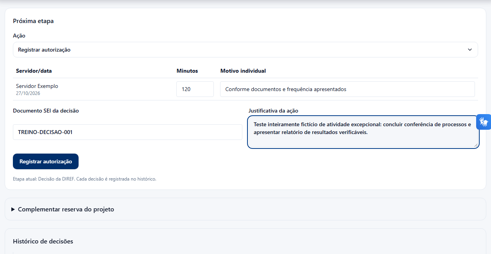

## Definir órgão escopo e vigência

Configuração e administração

**Responsável:** Administrador de configuração

**Caminho:** /administracao/horas-extras

1. Selecione o órgão e o escopo geral ou a unidade específica. Informe a vigência inicial da nova versão.
2. Use Continuar para percorrer as quatro etapas. A configuração desta tela atende ao pedido individual; a ordem de análise da campanha é escolhida no cadastro da própria campanha.

**Confira:** O resumo lateral deve identificar corretamente o órgão, o escopo e a vigência propostos.

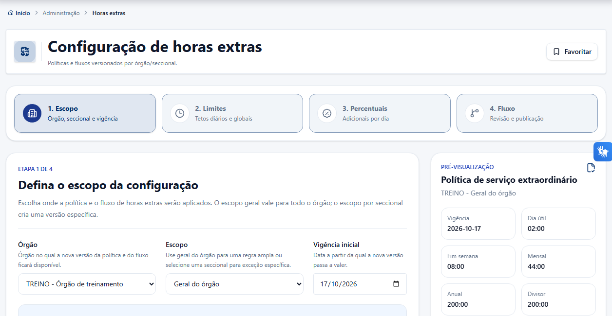

## Conferir limites e divisor

Configuração e administração

**Responsável:** Administrador com parâmetros validados

**Caminho:** /administracao/horas-extras

1. Informe os limites nos campos de tempo em HH:mm. Diferencie tempo diário, total mensal, total anual e divisor do cálculo.
2. O exemplo mostra 02:00 em dia útil, 44:00 no mês e 200:00 no ano. O divisor de 200 horas é informado como 200:00. Revise os parâmetros aplicáveis antes de publicar.

**Confira:** Os campos e a pré-visualização devem apresentar os mesmos valores.

**Atenção:** A configuração versionada do pedido individual não deve ser confundida com o conjunto de validações próprio das campanhas.

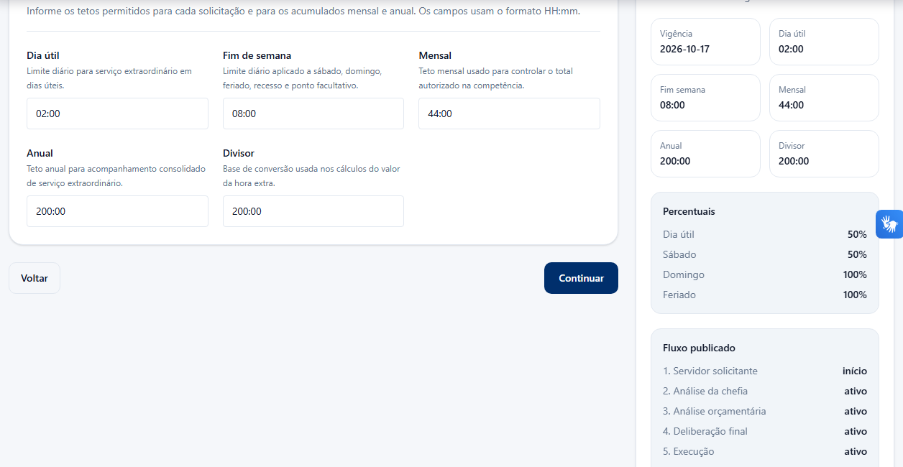

## Conferir percentuais por tipo de dia

Configuração e administração

**Responsável:** Administração e área responsável pela regra

**Caminho:** /administracao/horas-extras

1. Confira separadamente os adicionais de dia útil, sábado, domingo e feriado. O exemplo exibe 50%, 50%, 100% e 100%.
2. Revise o enquadramento do calendário e as regras aprovadas pelo órgão. A classificação de ponto facultativo deve ser conferida; nas campanhas, ele não recebe automaticamente adicional de 100%.

**Confira:** Percentual e tipo de dia devem estar coerentes com a versão e a modalidade utilizadas.

**Atenção:** O texto de ajuda da configuração individual agrupa hipóteses de calendário. Não o utilize como aprovação normativa ou como descrição da regra específica de campanhas.

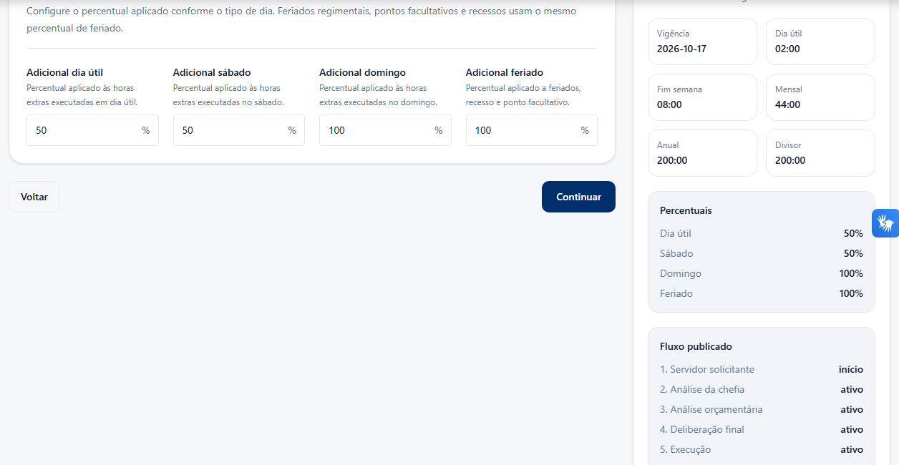

## Revisar o fluxo e publicar a versão

Configuração e administração

**Responsável:** Administrador autorizado

**Caminho:** /administracao/horas-extras

1. Revise as etapas e as permissões. Há modelos de fluxo, incluindo SJAM simplificado, SJRR completo e dupla aprovação; escolha conforme o procedimento aprovado.
2. Confira a ordem antes de usar Publicar versão. A publicação gera uma versão para o escopo escolhido. Preserve a rastreabilidade das versões usadas por pedidos anteriores.

**Confira:** Política e fluxo ativos devem aparecer na parte inferior da página.

**Atenção:** A tela permite configurar modelos, mas a ação atual Deferir na chefia conclui diretamente o pedido individual. Não presuma que as etapas orçamentária e deliberativa do modelo serão percorridas por essa ação. O projeto de campanha segue sua própria ordem de análises.

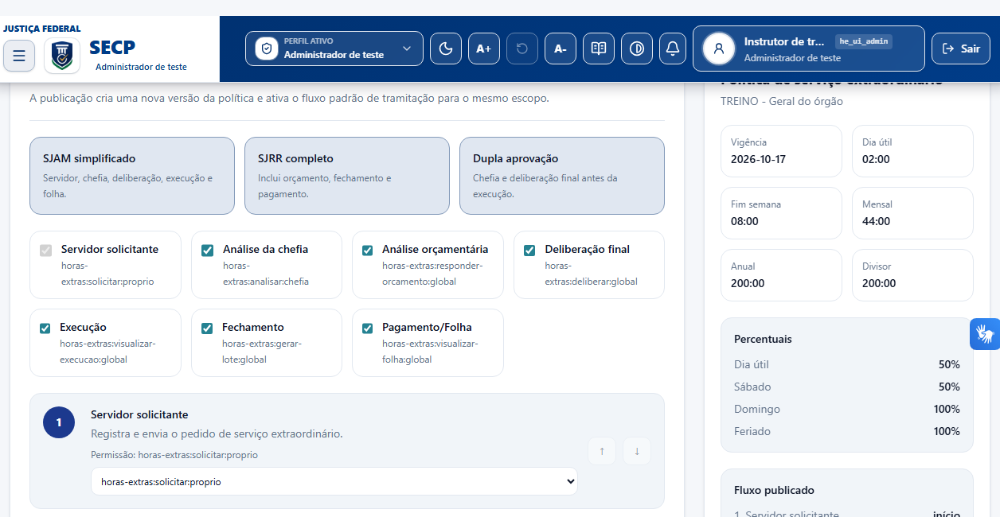

## Cadastrar a campanha específica

Cenário 1 Campanha específica

**Responsável:** Administração da campanha

**Caminho:** /horas-extras/campanhas/nova

1. Crie a Campanha específica de outubro. Informe órgão, exercício, código, nome, processo, documento autorizador, período, prazos, finalidade e critérios.
2. Escolha Administrativa > Orçamentária > DIREF, inclua a unidade participante e confira o valor de referência. Salve em rascunho e depois use Ativar campanha com justificativa.

**Confira:** A campanha fica ativa; os recursos continuam zerados até o registro dos atos financeiros.

**Atenção:** O exemplo traz referência de R$ 18.000,00 apenas para planejamento. Ela não representa crédito recebido.

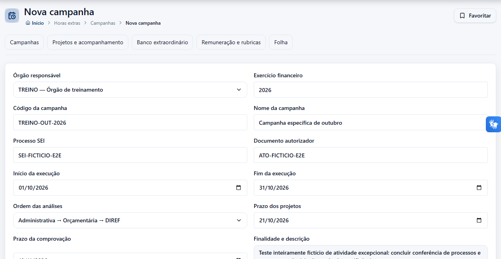

## Registrar recursos e conferir disponibilidade

Cenário 1 Campanha específica

**Responsável:** Área orçamentária

**Caminho:** /horas-extras/campanhas/{id}

1. Em Registrar ato financeiro, registre Alocar recursos e Registrar crédito descentralizado para a unidade. Informe valor, documento e justificativa em cada operação.
2. No exemplo, registre R$ 1.000,00 em cada ato. Confira a tabela antes de encaminhar projetos. Utilize remanejamento ou complementação somente com origem e cobertura documentadas.

**Confira:** Alocado R$ 1.000,00; descentralizado R$ 1.000,00; disponibilidade inicial R$ 1.000,00.

**Atenção:** Disponibilidade é o menor valor entre alocado e descentralizado, descontados reservas e execução financeira.

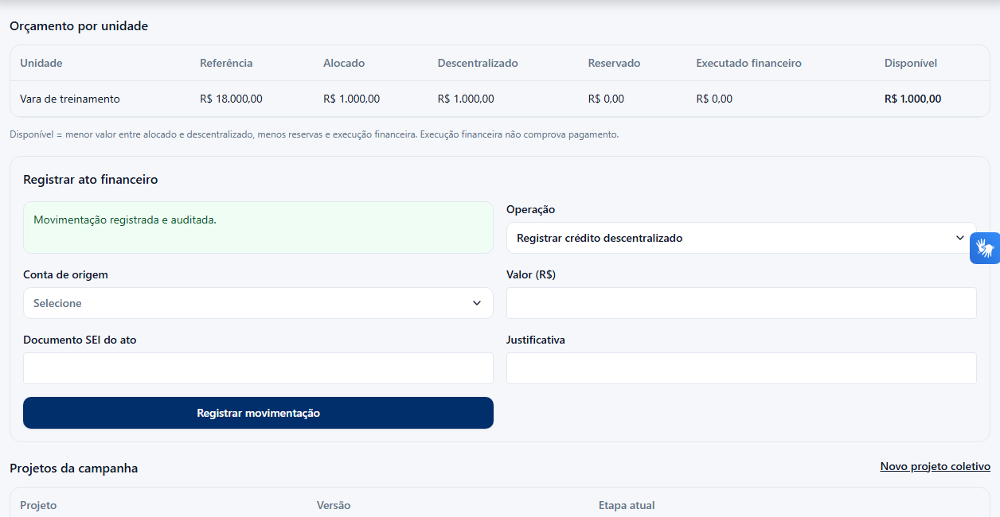

## Identificar o projeto e seu titular

Cenário 1 Campanha específica

**Responsável:** Chefia ou administrador na preparação

**Caminho:** /horas-extras/projetos/novo

1. Abra Novo projeto coletivo e selecione a campanha, a unidade e o titular responsável. Informe o título Mutirão de conferência processual e a referência do processo.
2. Escolha a chefia vigente; o administrador que prepara o cadastro não se torna o titular. Use Continuar para abrir a justificativa.

**Confira:** Campanha, unidade, titular e processo devem corresponder ao serviço planejado.

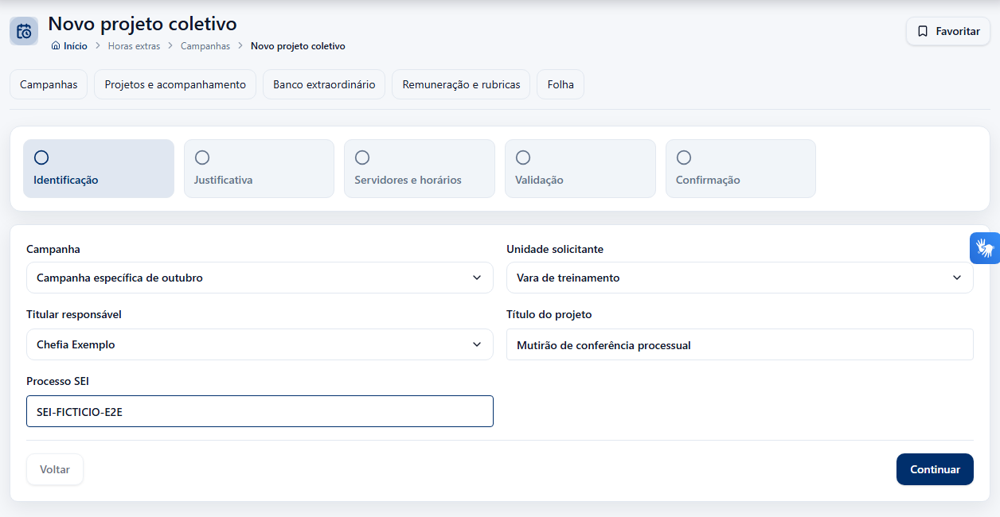

## Descrever a necessidade e os resultados

Cenário 1 Campanha específica

**Responsável:** Titular responsável

**Caminho:** /horas-extras/projetos/novo

1. Selecione o enquadramento da atividade. Descreva situação excepcional, atividades específicas, resultados esperados e impossibilidade de execução na jornada ordinária.
2. Quando houver urgência, informe fatos e documentos específicos. Para fins de semana e feriados, apresente a análise exigida das alternativas de execução.

**Confira:** A justificativa deve permitir que a área de análise entenda necessidade, atividade, prazo e resultado verificável.

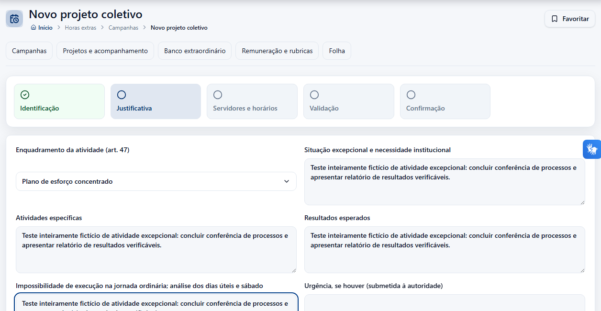

## Incluir servidores datas e horários

Cenário 1 Campanha específica

**Responsável:** Titular responsável

**Caminho:** /horas-extras/projetos/novo

1. Pesquise o servidor por matrícula ou nome e use Incluir servidor/data. Preencha data, início, fim, intervalo, modalidade e atividade individual.
2. No exemplo, use 22/10/2026, 16:00 a 18:00, Pagamento e estimativa de R$ 200,00. Repita a inclusão para outras pessoas ou datas.

**Confira:** Um item de duas horas para o servidor, fora da sua jornada ordinária.

**Atenção:** Os horários são início e fim de trabalho. O intervalo é informado em minutos. Confira lotação, jornada, afastamentos e sobreposição.

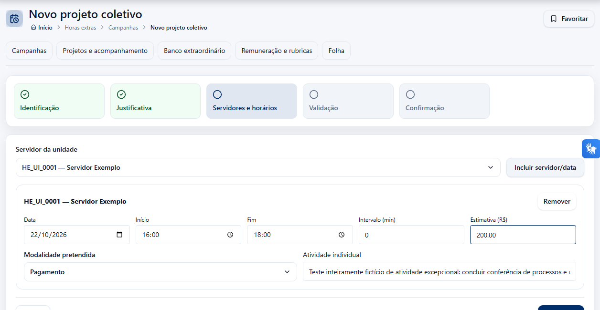

## Conferir e salvar a proposta

Cenário 1 Campanha específica

**Responsável:** Titular ou administrador preparador

**Caminho:** /horas-extras/projetos/novo

1. Passe por Conferência e Confirmação. Revise o título, a unidade, o processo, as justificativas e a quantidade de itens.
2. Use Salvar projeto. Na página criada, confira a versão em rascunho e execute Enviar para análise em Próxima etapa, com documento e justificativa.

**Confira:** O rascunho é preservado e, após envio, entra em Análise administrativa.

**Atenção:** Salvar não autoriza execução. Alterações posteriores são feitas por nova versão, dentro das condições permitidas.

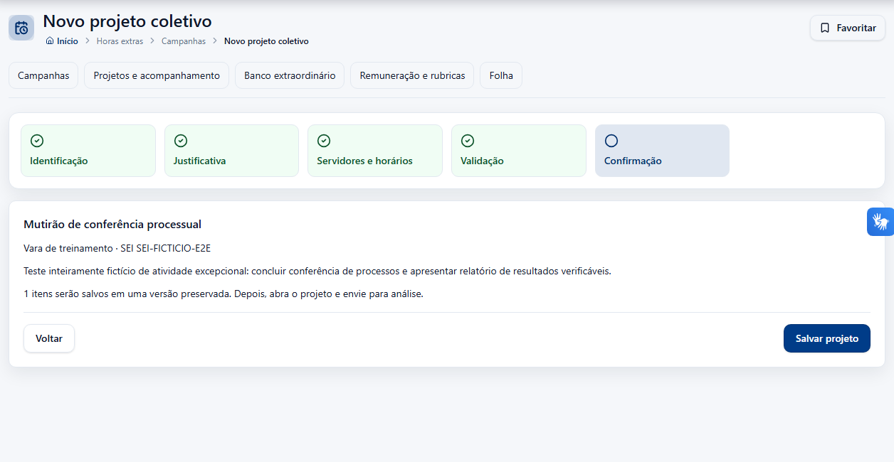

## Analisar o projeto na chefia

Cenário 1 Campanha específica

**Responsável:** Chefia e responsável pela análise

**Caminho:** /horas-extras/projetos/{id}

1. Abra o projeto pelo perfil de chefia. Confira unidade, titular, itens, necessidade, jornada e resultados. A chefia consulta suas unidades e unidades filhas conforme o vínculo e a permissão.
2. Na seção Próxima etapa, use Aprovar análise administrativa para encaminhar. Se houver inconsistência, utilize a ação de devolução disponível e registre o motivo.

**Confira:** Com aprovação administrativa, o projeto segue para Análise orçamentária.

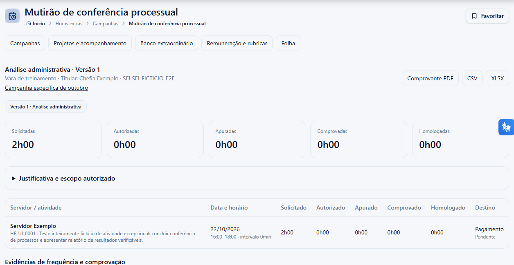

## Reservar orçamento e encaminhar à autoridade

Cenário 1 Campanha específica

**Responsável:** Área orçamentária

**Caminho:** /horas-extras/projetos/{id}

1. Confira o custo estimado e a disponibilidade da unidade. Em Próxima etapa, use Reservar orçamento e encaminhar, com o documento e a justificativa da análise.
2. No exemplo, a estimativa de R$ 200,00 é reservada. A decisão seguinte é da autoridade; a reserva não representa autorização nem pagamento.

**Confira:** Etapa Decisão da DIREF; a unidade passa a ter R$ 200,00 reservados e R$ 800,00 disponíveis.

## Registrar a autorização por item

Cenário 1 Campanha específica

**Responsável:** Autoridade competente

**Caminho:** /horas-extras/projetos/{id}

1. Escolha Registrar autorização. Confira cada servidor/data e informe os minutos autorizados e o motivo individual; zero representa indeferimento do item.
2. Para autorizar integralmente as duas horas do exemplo, informe 120 minutos. Registre documento e justificativa. A equipe só deve executar depois da autorização.

**Confira:** Projeto Autorizada, com 120 minutos autorizados e autorização administrativa vinculada.

**Atenção:** Autorização parcial libera a parcela correspondente da reserva. A retificação de versão autorizada deve anteceder a prestação.

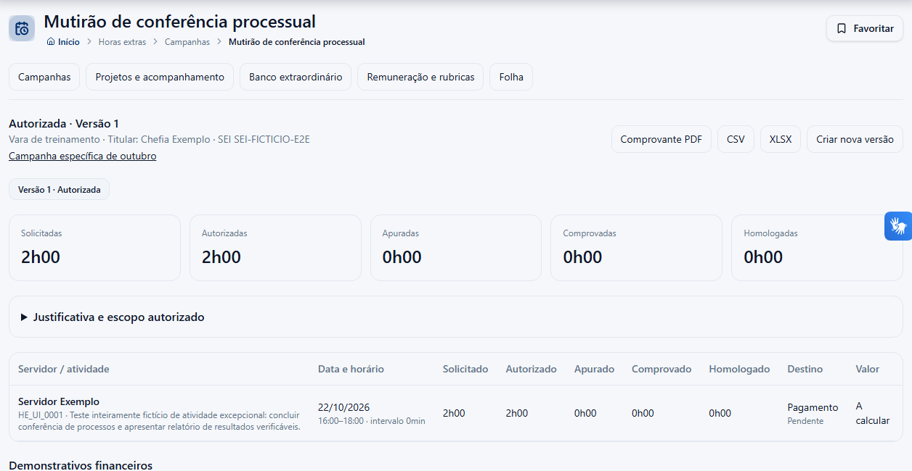

## Apurar as marcações efetivas

Cenário 1 Campanha específica

**Responsável:** Operador de apuração

**Caminho:** /horas-extras/projetos/{id}

1. Depois do serviço, selecione Apurar marcações. Abra Evidências de frequência e comprovação para conferir horários, fontes e inconsistências.
2. O SECP exclui a jornada ordinária e confronta os registros com o período autorizado. No exemplo, o resultado é de 120 minutos apurados.

**Confira:** Etapa Aguardando comprovação, com quantitativo sustentado pelas evidências.

**Atenção:** Marca ausente, ímpar ou inconsistente não cria horas. Tratamento documental excepcional exige autoridade, evidências e decisão; não insere biometria fictícia.

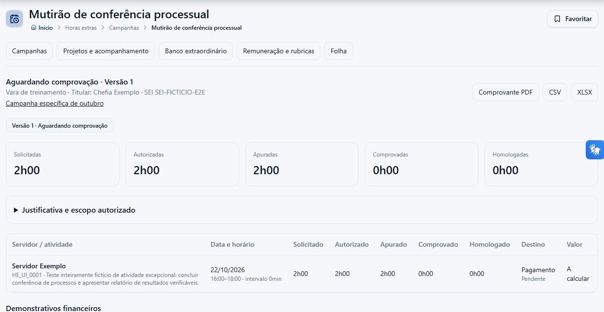

## Comprovar e homologar a prestação

Cenário 1 Campanha específica

**Responsável:** Titular na comprovação e autoridade na homologação

**Caminho:** /horas-extras/projetos/{id}

1. O titular usa Apresentar comprovação, informa resultados, documentos e minutos por item. Confira o prazo da campanha e o prazo de comprovação aplicável.
2. A autoridade usa Homologar prestação, podendo reconhecer menos minutos do que os comprovados. No exemplo, os 120 minutos são comprovados e homologados.

**Confira:** Solicitado, autorizado, apurado, comprovado e homologado permanecem separados; o projeto fica Homologada.

**Atenção:** Decisão sobre prazo e reconhecimento excepcional devem ser documentados. Homologação não libera pagamento automaticamente.

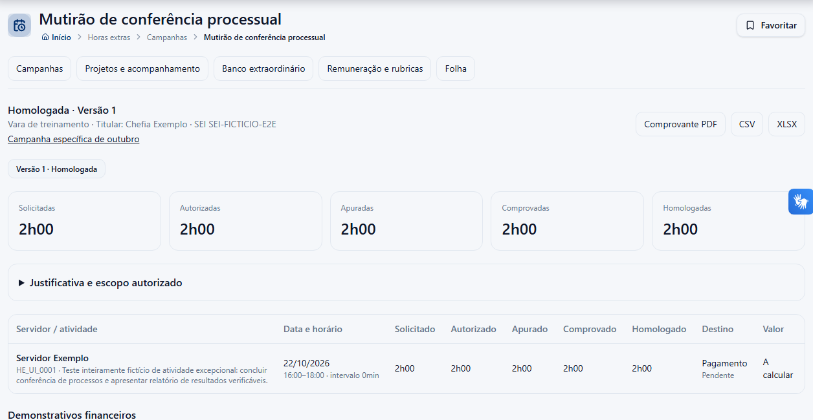

## Validar as rubricas remuneratórias

Cenário 1 Campanha específica

**Responsável:** RH com permissão para validar rubricas

**Caminho:** /horas-extras/remuneracao

1. Em Validar rubrica remuneratória, informe órgão, código, descrição, natureza, fundamento e vigência. Marque Integra a base de cálculo apenas quando a parcela estiver admitida.
2. Registre a validação. O exemplo utiliza uma rubrica fictícia de vencimento básico; na operação, utilize os códigos e fundamentos efetivamente aprovados.

**Confira:** Rubrica validada disponível para composição da remuneração histórica.

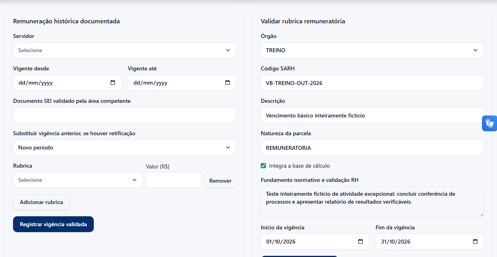

## Registrar a remuneração histórica

Cenário 1 Campanha específica

**Responsável:** RH com permissão para validar remuneração

**Caminho:** /horas-extras/remuneracao

1. Selecione o servidor, a vigência e o documento de origem. Inclua as rubricas com seus valores; no exemplo, a base fictícia é R$ 8.000,00.
2. A vigência precisa cobrir a data do serviço. Promoção ou alteração de função no mês exige vigências próprias. Retificação documental não reescreve cálculos anteriores.

**Confira:** Histórico validado, com parcelas e base vinculadas à data de prestação.

**Atenção:** O cadastro documentado supre a ausência de consulta histórica automática ao SARH. Não substitua uma base histórica pelo salário atual sem validação.

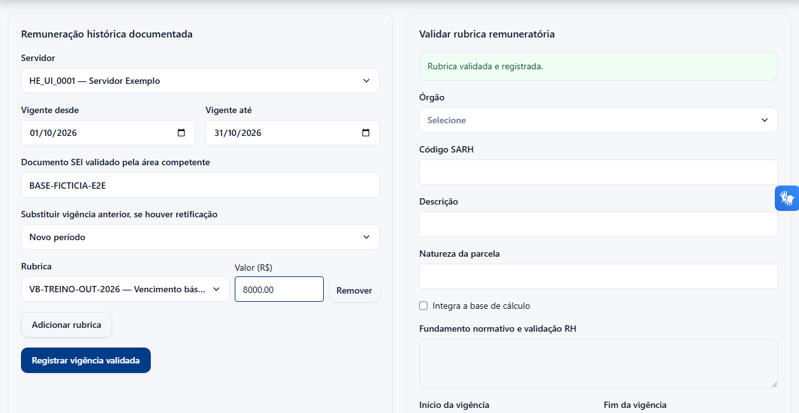

## Calcular e conferir o demonstrativo

Cenário 1 Campanha específica

**Responsável:** Financeiro

**Caminho:** /horas-extras/projetos/{id}

1. Execute Calcular valores e abra Demonstrativos financeiros. Confira rubricas, base, vigência, documento, divisor, adicional, minutos e total.
2. No exemplo: R$ 8.000,00 divididos por 200 horas, multiplicados por duas horas e por 1,5, resultam em R$ 120,00. Depois de conferir, use Liberar para folha.

**Confira:** Cálculo de R$ 120,00, coberto pela reserva, e projeto Liberada para folha.

**Atenção:** Histórico do banco anterior ausente ou negativo pode bloquear o cálculo. Utilize a decisão documental competente quando houver prova de regularização anterior ao serviço.

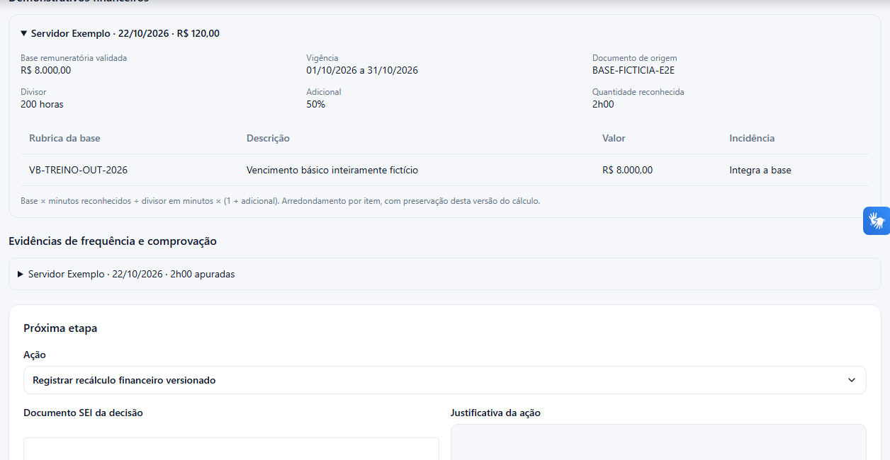

## Gerar conferir e fechar o lote

Cenário 1 Campanha específica

**Responsável:** Financeiro e folha

**Caminho:** /folha/horas-extras

1. Escolha órgão e competência e use Gerar lote de folha. Confira servidor, quantidade, adicional e valor. O lote de campanha admite itens calculados e liberados.
2. Use Fechar lote após a conferência. Exporte os arquivos de conferência disponíveis e registre a entrega conforme o procedimento da folha.

**Confira:** Lote fechado com R$ 120,00 no exemplo, sem inclusão repetida da mesma classificação.

**Atenção:** Fechar lote não significa pagamento. O leiaute externo e a integração automática dependem de homologação pela folha/SARH.

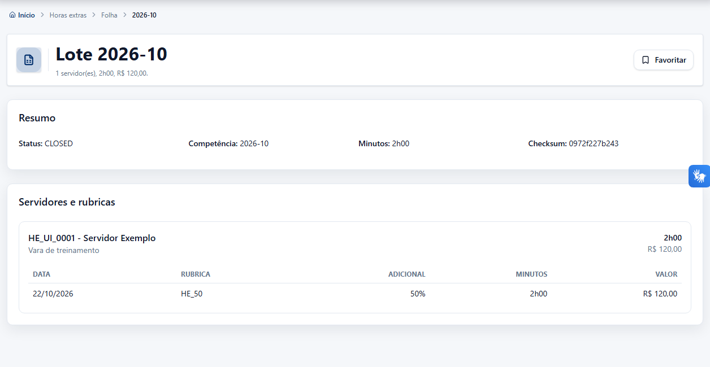

## Concluir e consultar o resultado

Cenário 1 Campanha específica

**Responsável:** Financeiro no encaminhamento e servidor na consulta

**Caminho:** /horas-extras/projetos/{id}

1. Após a entrega manual, retorne ao projeto e use Registrar encaminhamento à folha. Informe documento e justificativa; os lotes correspondentes devem estar fechados.
2. Peça ao participante que consulte o resultado com seu perfil. Teste PDF, CSV e XLSX. A consulta própria mostra seus itens e não expõe a base remuneratória reservada ao financeiro.

**Confira:** Projeto Concluída. No exemplo, reserva final R$ 0,00 e execução financeira R$ 120,00.

**Atenção:** O status registra encaminhamento documentado, sem afirmar que o crédito foi pago em folha.

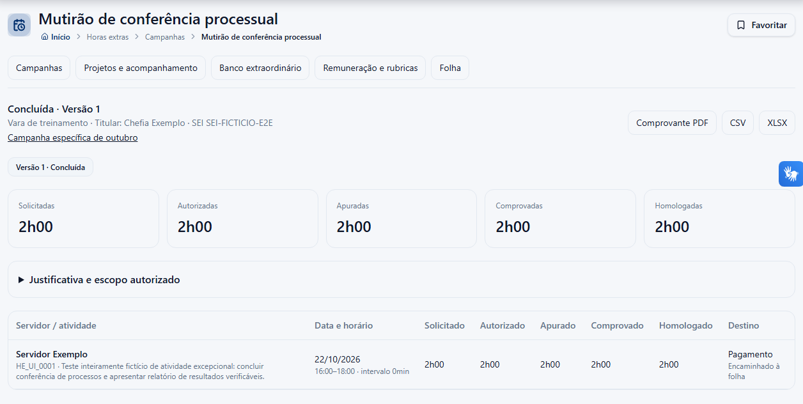

## Cadastrar o período de recesso

Cenário 2 Campanha de recesso forense

**Responsável:** Administração do recesso

**Caminho:** /recesso-forense/novo

1. Cadastre o recesso para a seccional e o ano. O módulo próprio define o período de 20/12 do ano informado até 06/01 do ano seguinte.
2. No exemplo, o recesso é 2026/2027. Descreva a finalidade e confira o período antes de criar a convocação.

**Confira:** Período de recesso disponível no calendário e no módulo próprio.

**Atenção:** Cadastrar uma campanha com nome de recesso não substitui o cadastro do período nem a convocação publicada.

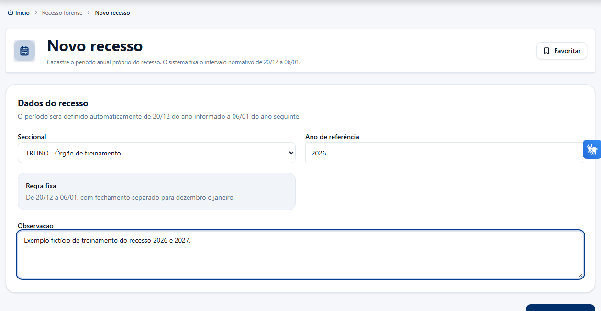

## Registrar a portaria e conferir a convocação

Cenário 2 Campanha de recesso forense

**Responsável:** Administração e chefia do recesso

**Caminho:** /recesso-forense/{id}/convocacoes

1. Informe número e data da portaria, unidade, chefia responsável e descrição. Use Criar convocação; confira a publicação e os servidores/datas vinculados.
2. O exemplo convoca o Servidor Exemplo para 21/12/2026, das 08h às 12h. A campanha exige convocação publicada, sem execução já processada em outro fluxo.

**Confira:** A portaria corresponde à unidade, ao servidor e à data do projeto.

**Atenção:** Limitação atual: a tela nativa em lote exige PECUNIA ou FOLGA, mas a campanha exige escolha PENDENTE. A convocação PENDENTE deste exemplo foi preparada por carga fictícia isolada. Não existe nessa tela um botão para reproduzir essa preparação; solicite conciliação administrativa antes de usar a campanha.

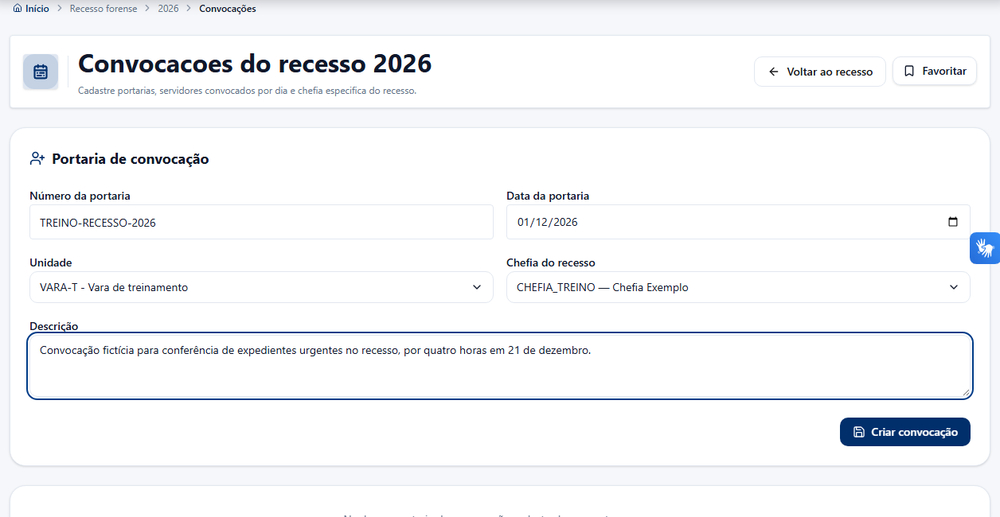

## Cadastrar a campanha que atravessa o exercício

Cenário 2 Campanha de recesso forense

**Responsável:** Administração da campanha

**Caminho:** /horas-extras/campanhas/nova

1. Cadastre Campanha de recesso forense, com período de 20/12/2026 a 06/01/2027 e documentos próprios. Informe os prazos definidos para o ato correspondente.
2. Inclua a unidade e ative a campanha. No exemplo, o destino será banco extraordinário; para pecúnia, também são necessários os atos financeiros e a cobertura da modalidade.

**Confira:** Campanha ativa, com vigência incluindo dezembro e janeiro.

**Atenção:** Os prazos das figuras são fictícios para treinamento. Não os copie como prazos oficiais do recesso.

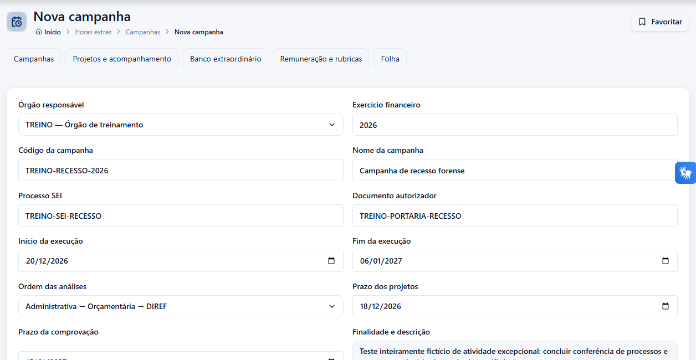

## Planejar o serviço do recesso

Cenário 2 Campanha de recesso forense

**Responsável:** Titular responsável

**Caminho:** /horas-extras/projetos/novo

1. Crie Atendimento urgente no recesso, selecione o titular e descreva necessidade, atividade e resultados. Inclua o servidor convocado em 21/12/2026, das 08:00 às 12:00.
2. Escolha Banco extraordinário e estimativa zero para esse item. Repita as análises e a autorização do cenário 1; após executar, apure, comprove e homologue os 240 minutos.

**Confira:** Quatro horas homologadas, vinculadas à convocação publicada e prontas para decisão de conversão.

**Atenção:** Se a convocação já possuir escolha ou processamento no módulo próprio, pare e concilie a origem. Não processe a mesma prestação em dois fluxos.

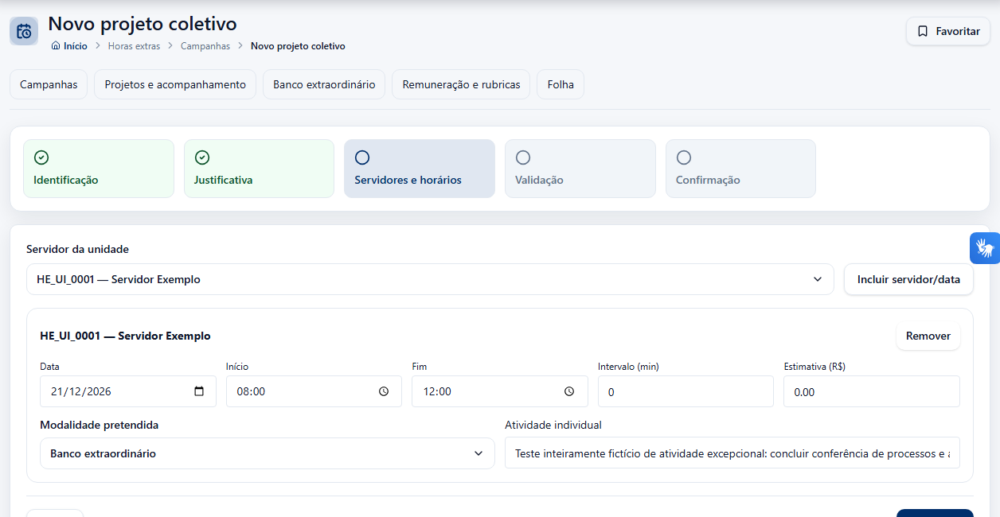

## Converter e conferir o crédito extraordinário

Cenário 2 Campanha de recesso forense

**Responsável:** Autoridade competente

**Caminho:** /horas-extras/projetos/{id} e /horas-extras/banco

1. Após homologar, escolha Converter em banco extraordinário. Selecione os itens, informe os minutos integrais de cada item, o documento, a justificativa e a validade autorizada. Depois use Concluir conversão.
2. Abra Banco extraordinário. No exemplo de recesso, 240 minutos com fator 2 geram 480 minutos, equivalentes a oito horas de crédito.

**Confira:** Crédito separado do banco ordinário, com origem, fator, saldo e vencimento.

**Atenção:** A validade exibida no exercício é 31/12/2028, dentro do prazo máximo aplicado pelo sistema para serviço de dezembro de 2026. A conversão depende de decisão expressa; falta de orçamento não converte horas automaticamente.

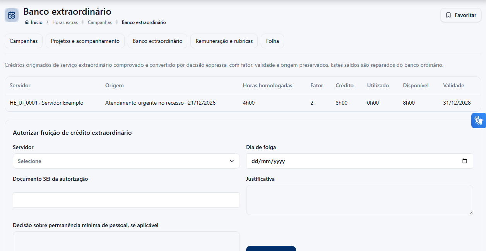

## Autorizar e conferir a fruição

Cenário 2 Campanha de recesso forense

**Responsável:** Autoridade responsável pela folga

**Caminho:** /horas-extras/banco

1. Em Autorizar fruição de crédito extraordinário, escolha servidor, dia de folga, documento e justificativa. Confira saldo, jornada do dia, vencimento, afastamentos e permanência de pessoal.
2. O exemplo usa uma folga de oito horas em 07/01/2027. Após Autorizar folga, confira o consumo e o registro no controle institucional de frequência.

**Confira:** 480 minutos utilizados e saldo zero no exemplo; nenhum débito no banco ordinário.

**Atenção:** A rotina utiliza dias completos e consome os créditos que vencem primeiro. Exceção sobre permanência mínima exige decisão documentada, quando aplicável.

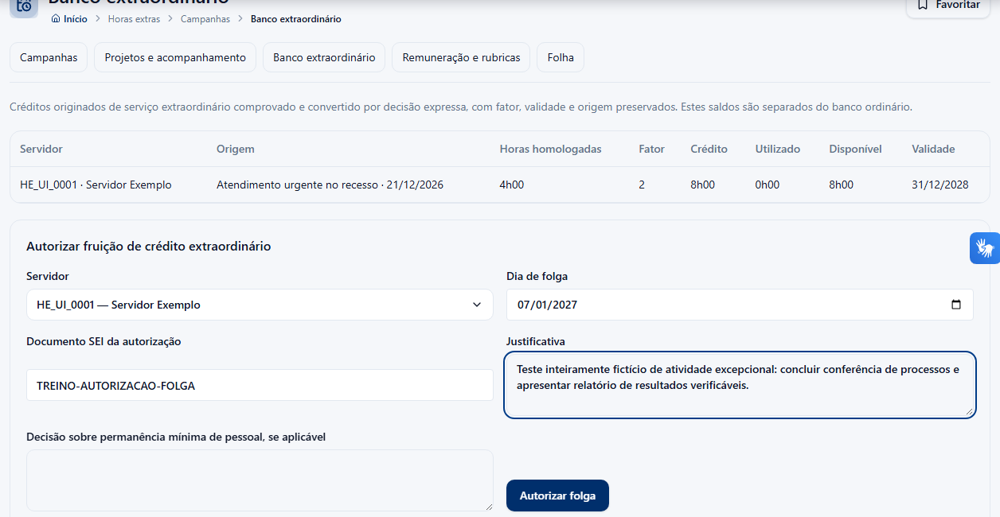

## Iniciar um pedido individual

Cenário 3 Pedido de um servidor

**Responsável:** Servidor com vínculo e permissão próprios

**Caminho:** /horas-extras/nova

1. Entre com o perfil do servidor e abra Nova solicitação em Horas extras. Informe início, fim, justificativa e atividades previstas.
2. O exemplo solicita duas horas em 30/10/2026 para conferência de expedientes. A política e o fluxo individuais precisam estar ativos para o órgão e o escopo do servidor.

**Confira:** Primeira etapa preenchida; use Avançar para informar os dias e o destino.

**Atenção:** Esse pedido não cria uma campanha nem integra automaticamente o projeto coletivo. Quando o ato exigir campanha, a chefia deve providenciar o projeto e referenciar a documentação do pedido, evitando duplicidade.

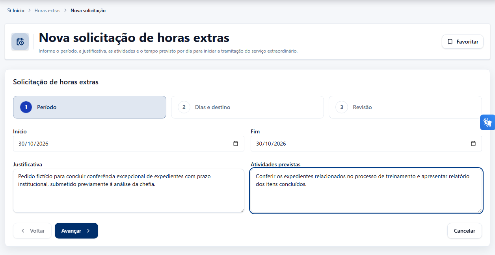

## Informar o tempo e o destino por dia

Cenário 3 Pedido de um servidor

**Responsável:** Servidor solicitante

**Caminho:** /horas-extras/nova

1. Na etapa Dias e destino, informe o tempo em HH:mm. Para duas horas, utilize 02:00. Dias com 00:00 não serão enviados.
2. Confira o tipo de dia, o limite apresentado e a escolha Pecúnia ou Banco. O pedido informa o tempo pretendido; a prestação efetiva continua dependendo de comprovação.

**Confira:** Um dia com 02:00 e destino Pecúnia, sem exceder o limite mostrado.

**Atenção:** O tempo desta tela é duração. Não preencha 16:00 para representar horário de início.

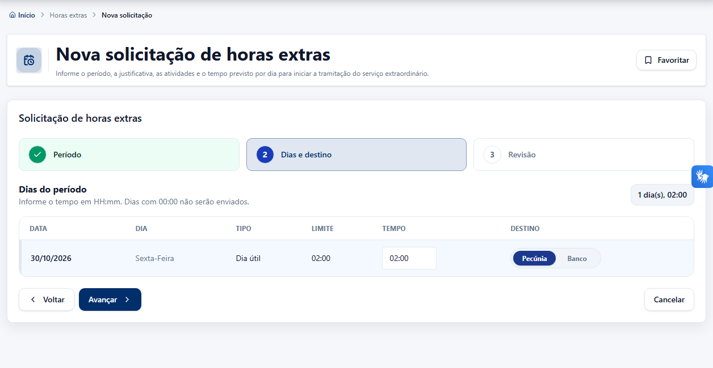

## Revisar e enviar a solicitação

Cenário 3 Pedido de um servidor

**Responsável:** Servidor solicitante

**Caminho:** /horas-extras/nova e /horas-extras

1. Na Revisão, confira período, dias, tempo total, destino e justificativas. Use Salvar rascunho se ainda precisar revisar ou Enviar solicitação para iniciar a tramitação.
2. Anote o número HE gerado e acompanhe em Minhas solicitações. Um pedido enviado não é autorização para trabalhar nem liberação financeira.

**Confira:** Pedido numerado e encaminhado à análise da chefia.

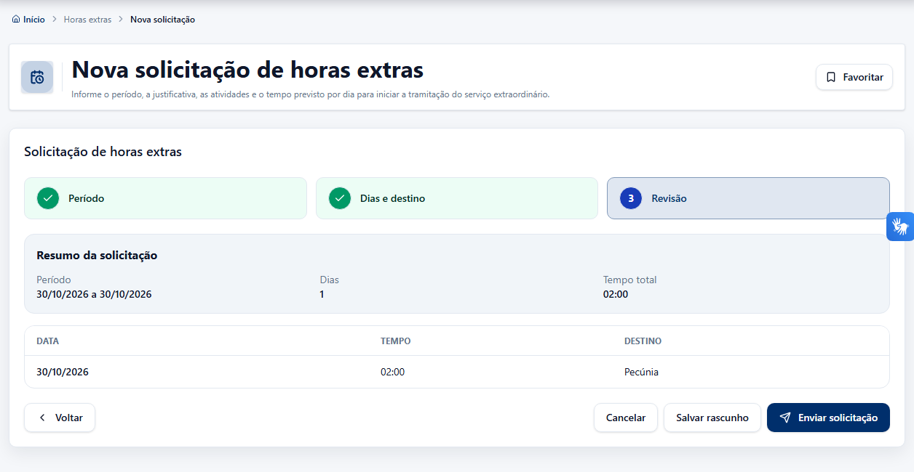

## Analisar o pedido na chefia

Cenário 3 Pedido de um servidor

**Responsável:** Chefia da unidade

**Caminho:** /gestao/horas-extras

1. Abra a fila da chefia e o pedido correspondente. Confira necessidade, datas, duração, destino e impacto na unidade.
2. Informe a justificativa da análise e use Deferir ou Indeferir. Na versão documentada, Deferir aprova diretamente o pedido e gera sua autorização, encerrando a etapa da chefia.

**Confira:** Decisão registrada; no deferimento, pedido aprovado e autorização individual gerada.

**Atenção:** O caminho atual não encaminha automaticamente esse deferimento para orçamento ou deliberação final, mesmo que o modelo de configuração liste essas etapas. Observe o procedimento institucional antes de utilizar essa autorização como fundamento financeiro.

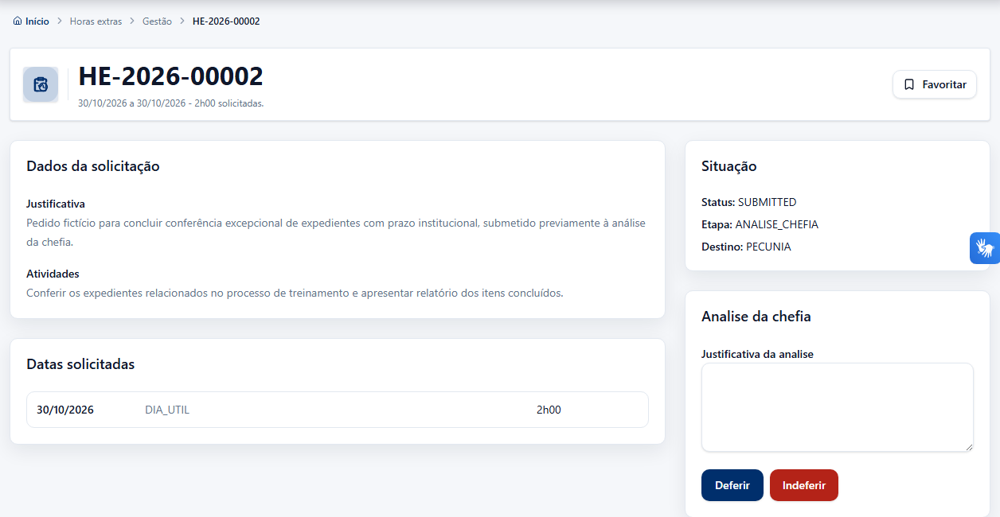

## Conferir a decisão individual

Cenário 3 Pedido de um servidor

**Responsável:** Chefia

**Caminho:** /gestao/horas-extras/{id}

1. Reabra o pedido após a decisão e confira sua situação, os minutos reconhecidos e o histórico. No exemplo, a chefia deferiu as duas horas solicitadas.
2. A autorização individual gerada deve ser distinguida do projeto coletivo e da autorização administrativa da campanha. Não registre a mesma prestação em dois caminhos para obter crédito ou pagamento duplicado.

**Confira:** Pedido individual aprovado, com a decisão da chefia preservada.

**Atenção:** Esse resultado não cria marcações, não reserva recursos de uma campanha e não confirma pagamento.

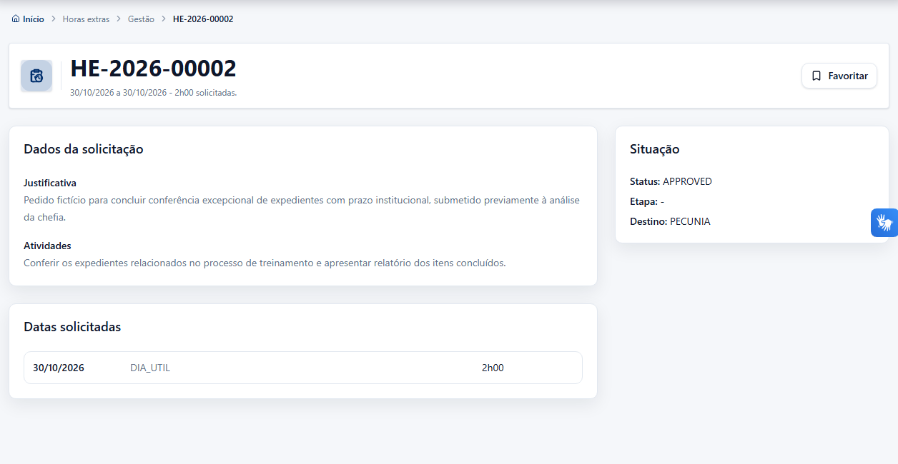

## Acompanhar pelo perfil do servidor

Cenário 3 Pedido de um servidor

**Responsável:** Servidor solicitante

**Caminho:** /horas-extras

1. Retorne a Minhas solicitações com o perfil do servidor. Localize o número HE, confira período, quantidade, destino e situação.
2. O exercício mostra o pedido de 30/10/2026 aprovado. Para atividades abrangidas por campanha, solicite à chefia o projeto correspondente e a conciliação documental, conforme a orientação institucional.

**Confira:** O servidor acompanha a decisão sem acessar a configuração ou os dados financeiros de terceiros.

**Atenção:** A frequência, a comprovação e os controles financeiros posteriores devem observar a modalidade autorizada e o procedimento aplicável. Não há vínculo automático com o lote demonstrado no cenário 1.

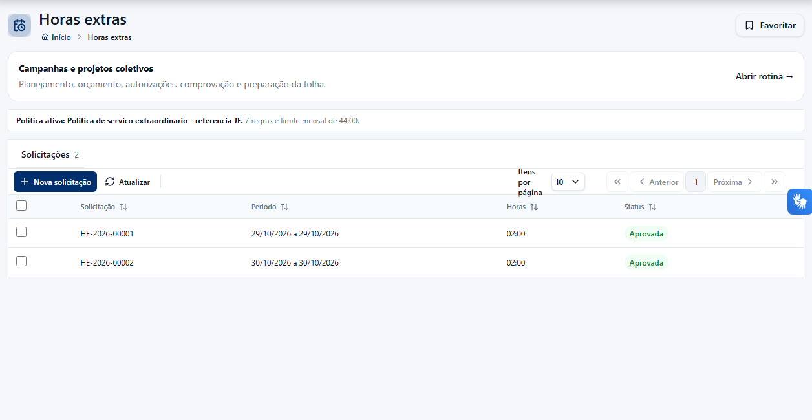

## Conferências para a chefia e a administração

Operação e encerramento

Antes de autorizar: confira atividade excepcional, justificativa, antecedência, jornada, lotação, afastamentos, intervalo e limites. Confira a fonte de recursos para pecúnia. No recesso, confira período, portaria, servidor, data e ausência de processamento duplicado.

Depois de executar: compare solicitado, autorizado, apurado, comprovado e homologado. Confira marcas e fontes, justificativas individuais, documentos e prazos. Quantidades diferentes devem ser explicadas; a menor quantidade homologada é a que orienta o desfecho financeiro.

Antes da folha: confira rubricas e remuneração histórica da data do serviço, divisor, adicional, arredondamento por item, cobertura da reserva e saldo histórico do banco anterior. Faça recálculo versionado antes do lote quando houver retificação salarial documentada.

Após inclusão em lote, uma correção exige procedimento financeiro próprio. Não apague o histórico encaminhado para obter um novo resultado. Registre o encaminhamento manual com documento e preserve o comprovante do lote fechado.

Para banco extraordinário: confira fator, validade autorizada, origem, saldo e pessoal remanescente antes da folga. A conversão disponível é por item homologado inteiro e a fruição é por dia completo.

Ao encerrar a campanha, confira projetos pendentes, reservas, parcelas executadas e documentos. Fechamento administrativo não substitui confirmação de pagamento pela folha.

## Mensagens frequentes e providências

Operação e encerramento

| Situação observada | Providência |
| --- | --- |
| Órgão, unidade ou servidor não aparece | Confira órgão e unidade ativos, hierarquia, lotação na data e escopo do perfil ativo. |
| Titular não aparece ou projeto fora da chefia | Confira o vínculo de chefia vigente da unidade ou de sua hierarquia e a permissão para apresentar projetos. |
| Antecedência insuficiente | Replaneje a data ou apresente urgência específica para a decisão competente. Não use data passada para autorizar. |
| Reserva sem cobertura | Confira alocação e crédito descentralizado, além de reservas e execução. Referência de planejamento não é recurso recebido. |
| Sem horas apuradas ou marca ímpar | Confira registros, origem e coleta. Encaminhe inconsistências ao tratamento documentado autorizado. |
| Sem remuneração histórica ou rubrica válida | Solicite validação ao RH para a data do serviço. Evite substituir por bruto ou salário atual. |
| Banco histórico ausente ou negativo | Apresente a evidência pertinente e a comprovação de compensação anterior, quando exigida. |
| Convocação do recesso já possui decisão | Interrompa o segundo processamento e solicite conciliação da origem. A campanha exige escolha pendente. |
| Lote sem itens ou inclusão repetida | Confira cálculo e liberação, órgão, competência e eventual lote já existente. Não tente duplicar a classificação. |
| Saldo insuficiente para folga | Confira crédito disponível e validade. A fruição atual exige saldo para o dia completo. |

## Roteiro de avaliação do treinamento

Operação e encerramento

Exercício 1: criar e ativar campanha, registrar R$ 1.000,00 de alocação e descentralização, apresentar um projeto de duas horas, reservar R$ 200,00, autorizar, apurar, comprovar, homologar, calcular e conferir R$ 120,00, liberar, fechar lote e registrar encaminhamento. Explicar por que referência, reserva e pagamento são conceitos distintos.

Exercício 2: identificar período e portaria do recesso, explicar a condição de escolha pendente da campanha e a limitação da tela nativa em lote. Com os pré-requisitos preparados pelo instrutor, converter quatro horas em oito horas de crédito e autorizar uma folga de oito horas, sem movimentar o banco ordinário.

Exercício 3: enviar um pedido individual de 02:00, anotar seu número, localizar na fila da chefia, deferir ou indeferir e conferir a autorização e a consulta do servidor. Explicar por que o deferimento atual é direto e por que o pedido não aparece automaticamente como projeto da campanha.

Conferências adicionais: testar devolução antes da autorização, autorização ou homologação parcial, nova versão anterior ao serviço, bloqueio sem descentralização, ausência de marcas, consulta própria sem demonstrativo financeiro e impedimento de inclusão duplicada na folha.

O instrutor deve registrar participante, perfil exercitado, cenário, data, resultado observado e dúvida pendente. A conclusão do treinamento funcional não equivale à homologação normativa nem à autorização de rubricas ou de crédito recebido.

Base do material: telas capturadas do SECP 1ad4bb4; guia operacional e relatório de validação em docs/horas-extras/reestruturacao-2026. Revisar este manual quando forem alterados os fluxos, a integração do recesso, os parâmetros ou o leiaute da folha.
